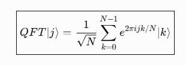
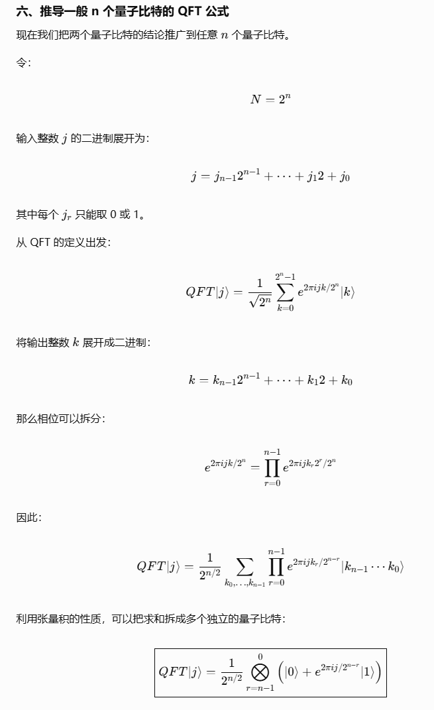
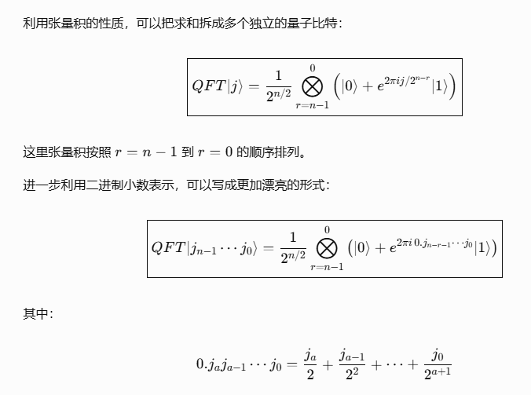
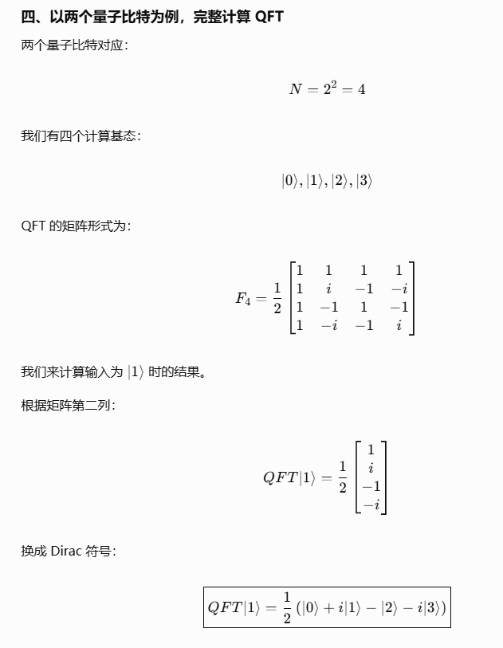

前期的内容在 [捌拾叁- 量子傅里叶变换](https://berrybc.github.io/%E4%B8%89%E4%B8%96%E4%B9%A6%E8%AE%B0%E5%BD%95/83-Quantum_fourier/)

前期的内容在 [捌拾肆- 量子傅里叶变换 (2)](https://berrybc.github.io/%E4%B8%89%E4%B8%96%E4%B9%A6%E8%AE%B0%E5%BD%95/84-Quantum_fourier_2/)

前期的内容在 [捌拾伍- 量子傅里叶变换 (3)](https://berrybc.github.io/%E4%B8%89%E4%B8%96%E4%B9%A6%E8%AE%B0%E5%BD%95/85-Quantum_fourier_3/)

## 久违的来看一下

今年整年的内容都是在看 `AI Agent`

感觉其实都没啥用

不是世界变得太快

而是应用场景其实比较有限

再有空回头来看一下量子电路, 居然已经完全忘记了

或许其实很多东西

都是看的时候没啥用, 就必须得多看, 不断看, 看熟悉了之后就突然懂了

*(虽然其实我现在也不是很懂, 但至少大概明白了很多内容其实不必纠结)*

## 核心

之前看的教程其实很多东西都不太对

(也不能说不对, 就是会很混淆)

例如:

里面的 `|j>` 是一个输入量子态

右边的 `j` 就是左边的输入量子态 (整体量子态, 而不是某一个量子比特)

而 `k` 是输出的量子态 (整体的量子态, 而不是某一个量子比特), 代表的是这个展开基态 (频率) 的振幅

而整体推导成量子电路可用的公式, 大概可以看下面的数学过程

展开左右两边可以显示如下:

其实中心就是把一个 `输入态` , 转化成不同 `振幅` 的基态

